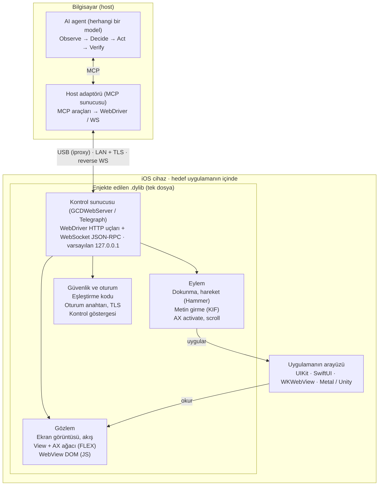

# iOS In-App Computer Use Bridge — Mimari ve Uygulama Planı

> Kaynak: Claude Docs belgesi [iOS In-App Computer Use Bridge — Mimari ve Uygulama Planı](https://claude.ai/artifact/VvCKyn5PJmtUc9qCXhBE2u), revizyon 10, 26 Kasım 2026.
> Diyagramlar burada Mermaid ve tablo olarak yeniden çizildi; özgün görüntüler `docs/img/` altında.
> "Açık sorular" bölümü bu dosyada genişletildi: verilen yanıtlar ve her soru için arka plan bilgisi eklendi.

## Amaç ve kapsam

Herhangi bir iOS uygulamasına tek bir .dylib enjekte ederek, harici bir AI agent'ın o uygulamayı gözlemleyip kontrol edebilmesini sağlayan, uygulamadan bağımsız bir köprü. Dylib yalnızca köprüdür; kararları dışarıdaki agent verir.

Sistem şu döngüyü destekler:

1. **Observe:** Ekran görüntüsü, ekran ölçüleri ve erişilebilirlik/view ağacı alınır.
2. **Decide:** Agent, görsel ve yapılandırılmış bilgiyi değerlendirir.
3. **Act:** Semantik eylem (eleman ID'si ile) ya da koordinat tabanlı eylem gönderilir.
4. **Verify:** Eylem yanıtıyla birlikte yeni durum döner, agent sonucu doğrular.

**Kapsam dışı:** iOS'un tamamını kontrol etmek, dylib yüklenmemiş uygulamalar, sandbox dışındaki kaynaklar, modelin cihazda çalışması ve belirli bir uygulamaya özel otomasyon.

**Temel ilke:** Mümkün olan her parça mevcut açık kaynak projelerden alınır. Yeni yazılacak kod, bu parçaları birleştiren katman ve protokolle sınırlıdır.

## Gereksinimlerin fizibilitesi

Gereksinimlerin çoğu karşılanabilir. Karşılanamayanların kaynağı iOS'un kod imzalama ve sandbox modelidir.

| Gereksinim | Durum | Not |
| --- | --- | --- |
| Tüm işlevsellik tek .dylib'de | Karşılanır | Statik bağlanan bağımlılıklarla tek binary |
| Jailbreak gerektirmemeli | Kısmen | Sideload ile çalışır; ancak App Store IPA'ları FairPlay ile şifreli, çözülmüş IPA gerekir |
| Kaynak koda erişim gerekmemeli | Karşılanır | Runtime introspection ve hooking yeterli |
| Dylib dışında değişiklik olmamalı | Karşılanamaz | LC_LOAD_DYLIB eklemek yeniden imzalama gerektirir; bundle ID, entitlement, keychain group, push ve App Attest etkilenebilir |
| Ek entitlement / Info.plist değişikliği yok | Kısmen | Bonjour duyurusu için `NSBonjourServices` gerekir; bu yüzden Bonjour'suz bağlantı modları kullanılır |
| Yardımcı iOS uygulaması yok | Karşılanır | Her şey hedef uygulamanın process'inde |
| UIKit / SwiftUI uyumu | Karşılanır | SwiftUI erişilebilirlik ağacı tembel oluşur |
| WebView uyumu | Kısmen | DOM ayrı process'te; yalnızca `evaluateJavaScript` ile okunur |
| Özel render motorları (Metal, Unity) | Kısmen | Ekran görüntüsü ve dokunma çalışır; semantik ağaç yoktur, koordinata düşülür |
| Agent'tan bağımsız | Karşılanır | WebDriver uyumlu protokol + host tarafında MCP adaptörü |
| Yetkisiz erişime karşı güvenli | Karşılanır | Varsayılan loopback, eşleştirme kodu, TLS |
| Arka planda çalışma | Karşılanamaz | Uygulama askıya alınınca sunucu durur; protokolde ayrı durum olarak bildirilir |

Secure text alanları ve DRM'li video ekran görüntüsünde boş görünür. Bankacılık gibi anti-tamper korumalı uygulamalar yeniden imzalamayı tespit edip çalışmayabilir.

## Mimari

Agent dışarıda karar verir; dylib yalnızca gözler ve uygular.

Özgün diyagram: [docs/img/mimari.png](img/mimari.png)

Agent ve MCP adaptörü bilgisayarda çalışır; cihaz tarafında yalnızca dylib içindeki sunucu ve üç modül vardır. Gözlem modülü arayüzü okur, eylem modülü arayüze girdi uygular.

## Yeniden kullanılacak projeler

Yeni yazılacak kod yalnızca bu parçaları bağlayan katmandır. Lisanslar ve en güncel iOS sürümüyle uyumluluk kullanmadan önce kontrol edilmeli; bu tablo web araması olmadan hazırlandı, durumlar yaklaşıktır.

| Proje | Ne için | Lisans (yaklaşık) | Kullanım şekli |
| --- | --- | --- | --- |
| Hammer (Lyft) | IOHIDEvent ile dokunma, kaydırma, çoklu dokunma | MIT | Kaynak koddan dylib'e gömülür |
| KIF | Sentetik UITouch/UIEvent, erişilebilirlik ile eleman bulma | Apache 2.0 | Hammer'a alternatif / yedek |
| EarlGrey | Senkronizasyon (animasyon, ana thread boşta mı) | Apache 2.0 | "UI durağan mı" kontrolü için referans |
| FLEX | View hiyerarşisi, nesne inceleme | BSD-3 | Hiyerarşi kodu alınır, UI'ı değil |
| LookinServer | Hiyerarşiyi USB üzerinden aktarma | GPL olabilir | Yalnızca referans; lisans uygunsa kod |
| GCDWebServer / Telegraph | Gömülü HTTP ve WebSocket sunucusu | BSD / MIT | Kontrol arayüzü |
| Peertalk | usbmuxd üzerinden USB iletişimi | MIT | USB modu (iproxy alternatifi) |
| Appium / WebDriverAgent | W3C WebDriver protokolü ve uç tanımları | Apache 2.0 / BSD | Protokol şeması alınır, kod değil |
| Frida Gadget | Jailbreak'siz enjekte edilen JS runtime | wxWindows | Hızlı prototip (Faz 0) |
| Azule, insert_dylib, optool | IPA'ya dylib ekleme | Çeşitli | Build/dağıtım aracı |
| Sideloadly, Feather | Yeniden imzalama ve kurulum | Kapalı / çeşitli | Dağıtım aracı |

Host tarafında, Appium'a bağlanan mevcut bir mobil MCP sunucusu kullanılabilir. Dylib WebDriver uyumlu olduğu sürece bunlar küçük değişikliklerle çalışır.

## Yetenek bazında teknik yaklaşım

| Yetenek | Yaklaşım | Kaynak | Sınır |
| --- | --- | --- | --- |
| Ekran görüntüsü | Key window üzerinde `drawViewHierarchyInRect:afterScreenUpdates:` | Yeni (küçük) | Secure alanlar, DRM boş çıkar |
| Metal / Unity ekranı | `CAMetalLayer` drawable yakalama (`presentDrawable` hook) | Yeni | Motor başına test gerekir |
| Canlı akış | CADisplayLink + JPEG (MVP), sonra VideoToolbox H.264 | Yeni | FPS ve CPU maliyeti |
| Ekran bilgisi | `UIScreen` bounds, scale, `interfaceOrientation`, safe area | Yeni (küçük) | Koordinatlar point cinsinden |
| View hiyerarşisi | Pencere ve view ağacını dolaşma | FLEX | Büyük ağaçlarda derinlik sınırı |
| Erişilebilirlik ağacı | `accessibilityElements`, label, traits, frame | KIF | SwiftUI için AX'in etkinleştirilmesi gerekebilir |
| Dokunma, kaydırma, çoklu dokunma | IOHIDEvent sentezi | Hammer | Private API, iOS sürümleriyle kırılabilir |
| Semantik eylem | `accessibilityActivate`, `accessibilityScroll`, increment | Yeni | Her eleman desteklemez, koordinata düşülür |
| Metin girme | First responder üzerinde `UITextInput` / `insertText` | KIF | Sistem klavyesi kontrol edilemez |
| WebView | `WKWebView` bulunup `evaluateJavaScript` ile DOM okunur | Yeni | Cross-origin iframe'ler erişilemez |
| UI durağanlığı | Animasyon ve ana thread kuyruğu izlenir | EarlGrey | Sonsuz animasyonlarda zaman aşımı |
| Yaşam döngüsü | `UIApplication` / scene bildirimleri | Yeni (küçük) | Arka planda sunucu durur |

Her eleman için kararlı bir ID üretilir (sınıf + erişilebilirlik identifier + ağaçtaki yol). Agent önce semantik eylemi dener, başarısız olursa elemanın frame merkezine koordinatla dokunur.

## Kontrol protokolü taslağı

Protokol iki katmanlıdır: W3C WebDriver/Appium uyumlu HTTP uçları (mevcut istemciler için) ve daha zengin native WebSocket kanalı (canlı akış, olaylar, birleşik observe).

**WebDriver uyumlu uçlar (alt küme):**

| Uç | İşlev |
| --- | --- |
| `POST /session` | Eşleştirme token'ı ile oturum açar |
| `GET /session/{id}/screenshot` | Base64 PNG |
| `GET /session/{id}/source` | Erişilebilirlik ağacı (XML, Appium XCUITest formatına yakın) |
| `POST /session/{id}/element` | Locator ile eleman bulma (accessibility id, predicate, xpath) |
| `POST /session/{id}/element/{eid}/click` | Semantik dokunma |
| `POST /session/{id}/element/{eid}/value` | Metin girme |
| `POST /session/{id}/actions` | W3C pointer actions: dokunma, sürükleme, çoklu dokunma |
| `GET /session/{id}/window/rect` | Ekran boyutu ve yönü |

**Native WebSocket kanalı (JSON-RPC 2.0):**

- `observe` → tek yanıtta ekran görüntüsü + sıkıştırılmış etkileşilebilir eleman listesi + ekran bilgisi + uygulama durumu
- `act` → `{type: tap|longPress|swipe|drag|type|activate, target: elementId | {x, y}}`; yanıtta sonuç, hata kodu ve isteğe bağlı yeni `observe`
- `waitForIdle` → UI durağanlaşana kadar bekler
- `stream.start` / `stream.stop` → canlı görüntü
- Sunucudan gelen olaylar: `lifecycle` (foreground, background), `screenChanged`

**Hata modeli:** Her yanıt `ok`, `code` (örn. `element_not_found`, `not_hittable`, `app_backgrounded`, `timeout`) ve `message` taşır.

## Güvenlik

Varsayılan durumda sunucu dışarıdan erişilemez; ağ erişimi açıkça etkinleştirilir ve eşleştirme ister.

- **Bağlanma adresi:** Varsayılan `127.0.0.1`. USB'den iproxy/Peertalk ile erişilir. LAN modu yalnızca yapılandırmayla açılır.
- **Reverse mod:** Dylib, yapılandırılmış agent adresine kendisi bağlanır. Cihazda dinleyen port olmaz.
- **Eşleştirme:** İlk bağlantıda uygulama üzerinde 6 haneli kod gösteren bir overlay açılır. Kod doğrulanınca uzun ömürlü bir eşleştirme anahtarı üretilir ve uygulamanın keychain'inde saklanır.
- **Oturum:** Her oturum kısa ömürlü bir token kullanır. Aynı anda tek kontrol eden istemci olur.
- **Şifreleme:** LAN ve reverse modda TLS zorunludur. Sunucu sertifikası eşleştirme sırasında pinlenir.
- **Görünürlük:** Kontrol aktifken ekranda küçük bir gösterge durur. Kullanıcı kontrolü tek dokunuşla kesebilir.
- **Yapılandırma:** Ayarlar dylib'e gömülü bir plist veya ortam değişkeniyle verilir. Hedef uygulamanın Info.plist'ine dokunulmaz.

## Yol haritası

Frida prototipiyle başla; her faz bir doğrulama kapısıyla biter.

| Faz | Kapsam | Sonraki faza geçiş kapısı |
| --- | --- | --- |
| 0 · Prototip (Frida Gadget + JS) | Ekran görüntüsü, AX ağacı ve tap, WebSocket üzerinden. UIKit, SwiftUI ve bir WebView uygulamasında denenir | ODAV döngüsü 3 örnek uygulamada çalışıyor |
| 1 · MVP dylib (native, USB modu) | GCDWebServer + WebSocket JSON-RPC (observe, act). Ekran görüntüsü, AX ağacı, Hammer ile tap ve swipe. Yalnızca 127.0.0.1, iproxy ile bağlantı | Agent bir UIKit uygulamasında görevi bitiriyor |
| 2 · Etkileşim (WebDriver + MCP) | Metin girme, uzun basma, sürükleme, çoklu dokunma. Semantik eylemler ve waitForIdle. WebDriver uçları; host tarafında MCP adaptörü | Mevcut Appium istemcisi ve MCP sunucusu bağlanıyor |
| 3 · Güvenlik ve ağ (eşleştirme, TLS) | Eşleştirme kodu ekranı, oturum anahtarı. TLS ve sertifika pinleme. LAN ve reverse WebSocket modları | Yetkisiz bağlantı reddediliyor, LAN modunda TLS zorunlu |
| 4 · Genişletme (zor hedefler) | Canlı akış (önce JPEG, sonra H.264). WebView DOM okuma. Metal / Unity ekran yakalama | — |

Özgün diyagram: [docs/img/yol-haritasi.png](img/yol-haritasi.png)

Bir faz, altındaki kapı sağlanmadan bir sonrakine geçmez. Faz 0 başarısız olursa native dylib'e yatırım yapılmadan yön değiştirilebilir.

## Riskler

- Private API'ler (IOHIDEvent, AX etkinleştirme) yeni iOS sürümlerinde kırılabilir. Her yeni iOS sürümünde regresyon testi gerekir.
- Anti-tamper ve jailbreak tespiti olan uygulamalar yeniden imzalanmış paketi reddedebilir.
- Yeniden imzalanmış uygulamaları otomasyonla kullanmak birçok uygulamanın kullanım şartlarına aykırı olabilir. Kendi uygulamaların ve test amaçlı kullanım güvenli alan.
- GPL lisanslı kod (örn. LookinServer) dylib'e gömülürse tüm dylib GPL olur.

## Kararlar ve açık sorular

### Karar: Hedef iOS sürümü — en güncel sürüm

- [x] Minimum iOS sürümü kaç olacak?

Geliştiricinin cihazı en güncel iOS sürümünde. Hedef şimdilik yalnızca bu sürüm; eski sürümler kapsam dışı. 26 Kasım 2026 itibarıyla en güncel ana sürüm büyük olasılıkla **iOS 27** (Eylül 2026'da çıktı, 27.x güncellemeleri sürüyor). Kesin numara cihazda *Ayarlar → Genel → Hakkında* ekranından doğrulanmalı.

Bu kararın sonuçları:

- **Test matrisi küçülür:** Private API'ler (IOHIDEvent, AX) yalnızca tek bir ana sürümde doğrulanır.
- **Yıllık bakım:** Her Eylül'deki yeni ana sürüm, Hammer'ın IOHIDEvent sentezini ve AX etkinleştirmeyi kırabilir. Bu yüzden "en güncel" hedefi her yıl bir regresyon turu demektir.
- **Araç zinciri:** Güncel SDK'yı içeren Xcode sürümü gerekir. Yeniden kullanılacak projelerin (özellikle Hammer, KIF, FLEX, GCDWebServer) bu sürümde derlenip çalıştığı Faz 0–1'de doğrulanmalı. Bazıları uzun süredir güncellenmemiş olabilir.
- **Swift:** Swift ABI iOS 12.2'den beri işletim sisteminde, bu yüzden Swift çalışma zamanı dylib'e gömülmez. Swift 6 ve en yeni dil özellikleri sorunsuz kullanılabilir.
- **Developer Mode:** iOS 16'dan beri, geliştirici sertifikasıyla imzalanmış (sideload edilmiş) uygulamaları çalıştırmak için cihazda *Ayarlar → Gizlilik ve Güvenlik → Geliştirici Modu* açık olmalı.

### Açık: Ana dil Objective-C mi, Swift mi?

- [ ] Ana dil Objective-C mi, Swift mi?

Bileşenlerin dilleri: Hammer Swift; KIF, FLEX, GCDWebServer, Peertalk Objective-C; Telegraph Swift.

| Kriter | Objective-C ağırlıklı | Swift ağırlıklı |
| --- | --- | --- |
| Hooking / method swizzling | Doğal: `method_exchangeImplementations`, Logos (Theos) | Mümkün ama `@objc` ve `dynamic` gerekir, daha dolambaçlı |
| Private API (IOHIDEvent, AX) | C/ObjC başlıkları ve `dlsym` ile doğrudan | Bridging header veya modül haritası gerekir |
| Dylib boyutu | Küçük | Biraz daha büyük (Swift runtime işletim sisteminde olduğu için fark sınırlı) |
| Sınıf adı çakışması | Hedef uygulama aynı kütüphaneyi (ör. FLEX) içeriyorsa çakışır; sınıflara önek gerekir | Swift tipleri modül adıyla isimlendirilir, çakışma riski daha düşük |
| Sunucu, protokol, JSON, async | Daha fazla kalıp kod | `Codable` ve async/await ile daha kısa |
| Theos desteği | Birinci sınıf | Orion ile var ama daha az olgun |
| Hammer'ı kullanmak | Swift modülünü ObjC'den çağırmak için `@objc` sarmalayıcı gerekir | Doğrudan |

Karma yaklaşım da mümkün: hook ve private API katmanı Objective-C, sunucu ve protokol katmanı Swift. Bu durumda Theos yerine Xcode framework hedefi daha kolay olur. Belgede bu soruya bırakılmış bir yorum var.

### Açık: Host adaptörü mevcut bir mobil MCP sunucusu mu, ince bir özel adaptör mü?

- [ ] Host adaptörü mevcut bir mobil MCP sunucusu mu olacak, yoksa ince bir özel adaptör mü?

| Seçenek | Nasıl bağlanır | Artı | Eksi |
| --- | --- | --- | --- |
| [mobile-next/mobile-mcp](https://github.com/mobile-next/mobile-mcp) | Gerçek cihazda go-ios tüneli + WebDriverAgent'ın 8100 portu (`ios forward 8100 8100`) | Tek `npx` komutuyla kurulum, iOS ve Android | WDA'nın kendine özgü (W3C dışı) uçlarını da çağırıyor olabilir; dylib'in WDA'yı ne kadar taklit etmesi gerektiği `src/ios.ts` okunarak doğrulanmalı. Yol haritasında WDA yerine kendi "Device Kit"lerine geçiş var |
| [appium/appium-mcp](https://github.com/appium/appium-mcp) + Appium XCUITest sürücüsü | `appium:webDriverAgentUrl` (ör. `http://localhost:8100`) ile zaten çalışan bir WDA'ya bağlanır; dylib kendini WDA gibi sunar | Faz 2 kapısını ("mevcut Appium istemcisi bağlanıyor") doğrudan test eder | Appium, WDA'dan W3C alt kümesinden fazlasını bekleyebilir (`/status`, `/wda/...` uçları); katman sayısı artar |
| İnce özel adaptör (TypeScript veya Python MCP SDK) | Doğrudan native WebSocket kanalına (`observe`, `act`, `waitForIdle`) | Birleşik `observe` ve canlı akış gibi zengin özellikler tam kullanılır; birkaç yüz satır | Mevcut ekosistemle uyumluluğu ayrıca test etmek gerekir |

Not: Seçenekler birbirini dışlamıyor. Özel adaptör birincil yol olabilir, mevcut sunucular da WebDriver uyumluluğunun testi olarak kullanılabilir.

### Açık: İlk test hedefi olarak hangi uygulamalar kullanılacak?

- [ ] İlk test hedefi olarak hangi uygulamalar kullanılacak (UIKit, SwiftUI, WebView, Unity için birer örnek)?

Arka plan:

- **Kendi derlediğin açık kaynak uygulamalar en kolay yol.** FairPlay şifre çözme gerekmez, imzalama senin kontrolünde olur ve kullanım şartları sorunu çıkmaz. Test hedefinin lisansı önemsizdir, çünkü dylib'e gömülmez.
- **İmzalama sınırları:** Ücretsiz Apple ID ile imzalanan uygulamalar 7 gün geçerlidir ve aynı anda sınırlı sayıda (3) uygulama kurulabilir. Ücretli Apple Developer Program'da (yıllık 99 USD) sertifika 1 yıl geçerlidir.
- **Faz 0 kapısı** UIKit, SwiftUI ve WebView'den birer örnek istiyor; Unity/Metal Faz 4'e kadar beklenebilir.

Aday örnekler (doğrulanmamış; güncel sürümde derlendiği kontrol edilmeli):

| Tür | Aday | Not |
| --- | --- | --- |
| UIKit | Apple'ın *UIKit Catalog* örnek kodu | Çok sayıda standart kontrol; AX ağacı testi için iyi |
| UIKit + WebView | Wikipedia iOS uygulaması (açık kaynak) | Gerçek dünya karmaşıklığında UIKit + WKWebView |
| SwiftUI | Apple'ın SwiftUI eğitimlerindeki *Landmarks* uygulaması veya Xcode'un SwiftUI şablonuyla küçük bir uygulama | Tembel oluşan AX ağacını test etmek için |
| WebView | Firefox for iOS (açık kaynak) veya tek bir `WKWebView` içeren küçük bir uygulama | DOM okuma ve cross-origin sınırı |
| Metal | Xcode'un *Game* şablonu (Metal) | Semantik ağaç yok, koordinata düşme testi |
| Unity | Unity'nin örnek projelerinden Xcode'a dışa aktarılmış bir build | Unity Editor ve Mac gerekir |

## Geliştirme ortamı

Geliştirme Linux üzerinde yapılır; macOS'a ve Xcode'a yalnızca GitHub Actions'taki macOS runner'larında erişilir. Mac gerektiren tek adım derlemedir.

| İş | Nerede | Araç |
| --- | --- | --- |
| Dylib ve test uygulamalarını derleme | GitHub Actions, macOS runner | `xcrun clang` / `xcodebuild`, iş akışı: [.github/workflows/build.yml](../.github/workflows/build.yml) |
| Xcode sürümü seçimi | GitHub Actions | İş akışı runner'daki en yeni Xcode'u seçer ve iOS SDK sürümünü loglar |
| IPA'ya dylib ekleme | Linux | `insert_dylib` |
| Yeniden imzalama | Linux (veya CI, sertifika GitHub Secrets'ta) | `zsign` |
| Cihaza kurulum | Linux | `ideviceinstaller` (libimobiledevice) ya da cihazda Feather |
| USB bağlantısı (Faz 1) | Linux | `usbmuxd` + `iproxy` |
| iOS 17+ geliştirici servisleri | Linux | go-ios veya pymobiledevice3 tüneli (dylib'in kendi portu için gerekmez) |
| Loglar ve çökme raporları | Linux | `idevicesyslog`, `idevicecrashreport` |
| Faz 0 prototipi | Linux | Frida (host tarafı) |
| Host adaptörü ve protokol testleri | Linux veya Linux runner | Platformdan bağımsız |

Kısıtlar:

- **Xcode gecikmesi:** Yeni Xcode, `macos-latest` imajına aylar sonra gelir (Kasım 2026'da hâlâ Xcode 26.6 / iOS 26.5 SDK). Bu yüzden iş akışı iki runner'da derler: iOS 27 SDK'lı `xcode-27` önizleme imajı (standart boyut, ücretsiz; önizleme olduğu için kuyruk veya kararsızlık olabilir, başarısızlığı derlemeyi kırmaz) ve kararlı yedek olarak `macos-latest`. Dylib eski API'ler kullandığı için iki çıktı da iOS 27 cihazda çalışır. `xcode-27` GA olup `macos-latest`'e geçince matris tek runner'a indirilebilir. Kaynak: [actions/runner-images](https://github.com/actions/runner-images), [Xcode 27 önizleme duyurusu](https://github.com/actions/runner-images/issues/14404).
- **Maliyet:** Public repoda macOS runner'ları ücretsizdir. Repo private yapılırsa macOS dakikaları kotayı hızlı tüketir.
- **İmzalama:** CI dylib'i yalnızca ad-hoc imzalar. Asıl imza, dylib IPA'ya eklendikten sonra yeniden imzalama sırasında atılır.
- **Hata ayıklama:** Xcode olmadan cihazda kesme noktası ve adım adım ilerleme yoktur. Hata ayıklama loglar, çökme raporları ve Frida ile yapılır.
- **Theos alternatifi:** Theos'un Linux toolchain'iyle yerel derleme mümkündür, ancak SDK paketleri en güncel iOS'un gerisinde kalabilir ve Swift desteği zayıftır. Varsayılan yol CI'dır.
- **Dil seçimine etkisi:** Linux'ta en rahat yol CI'da `clang`/`swiftc` ya da Xcode framework hedefidir. Bu, Theos/Logos'un Objective-C avantajını azaltır.

## Claude Code ile geliştirme notları

- Repo yapısı önerisi: `dylib/` (Theos veya Xcode framework target), `host/` (MCP adaptörü, Node veya Python), `protocol/` (JSON şemaları), `prototype/` (Frida betikleri), `third_party/` (submodule olarak Hammer, KIF, GCDWebServer).
- Bu dokümanın Markdown export'u repoya `docs/SPEC.md` olarak, özeti `CLAUDE.md` olarak konabilir.
- Claude Code'un çalıştığı Linux ortamında iOS derlemesi yapılamaz (macOS ve Xcode gerekir). Derleme GitHub Actions macOS runner'ında yapılır (bkz. Geliştirme ortamı); cihaz testleri Linux'tan libimobiledevice ile yapılır. Host adaptörü ve protokol testleri her yerde çalışır.
- Önce protokol şemaları ve sahte (mock) bir dylib sunucusu yazılırsa host tarafı cihaz olmadan geliştirilebilir.

## Kaynaklar

Açık sorulara eklenen arka plan için bakılan sayfalar (26 Kasım 2026; çoğu yalnızca arama sonucu, sayfalar tek tek açılmadı):

- [mobile-next/mobile-mcp](https://github.com/mobile-next/mobile-mcp) ve [ROADMAP.md](https://raw.githubusercontent.com/mobile-next/mobile-mcp/main/ROADMAP.md)
- [mobile-mcp wiki: Getting Started with iOS Real Device](https://github-users.yhajoa.workers.dev/mobile-next/mobile-mcp/wiki/Getting-Started-with-iOS-Real-Device)
- [appium/appium-mcp](https://github.com/appium/appium-mcp)
- [Appium XCUITest driver: Attach to a running WDA](https://appium.github.io/appium-xcuitest-driver/6.2/guides/attach-to-running-wda) ve [capabilities](https://github.com/appium/appium-xcuitest-driver/blob/master/docs/reference/capabilities.md)
- [Apple: About iOS 26 Updates](https://support.apple.com/123075) ve [Apple Developer release notes](https://developer.apple.com/news/releases/)
